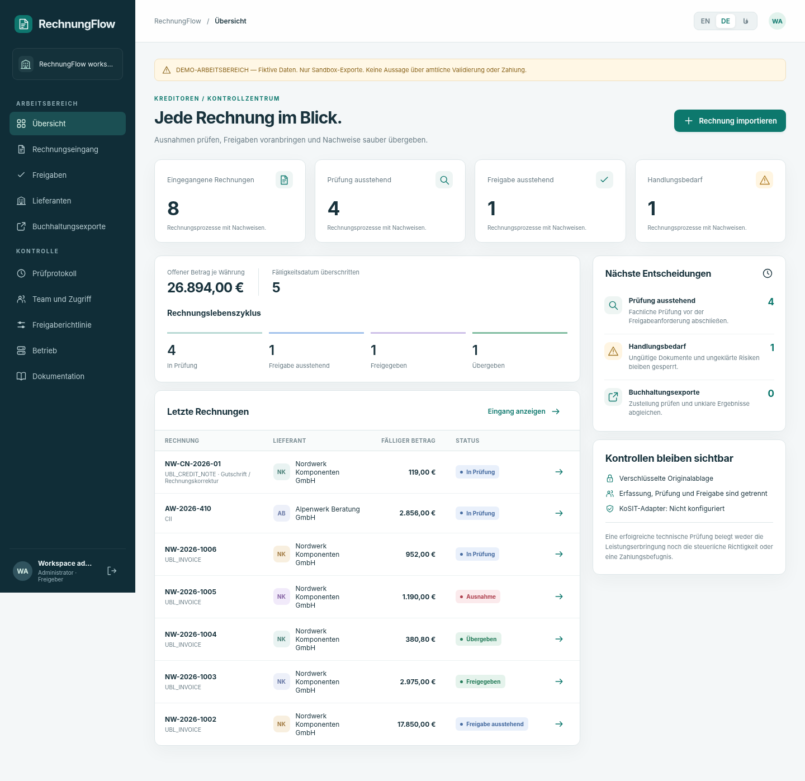

# RechnungFlow.

**E-Rechnungseingang, unabhängige Freigaben und belastbare Buchhaltungsübergabe.**

[English](README.md) · [فارسی](README.fa.md).

Java 21 · UBL-/CII-XML · Englisch / Deutsch / Persisch · Einzelinstanz-Engineering-Preview.



## Implementiert.

Verschlüsselte unveränderte Originale, XML-Eingang mit Namensraumprüfung, Dubletten und Berichtigungen, begrenzte Plausibilitätsprüfungen, isolierte gepinnte KoSIT-Anbindung, Prüfverlauf, Lieferantenbankprüfung, unabhängige Prüfung und schwellwertabhängige Freigabe, Richtlinienversionen, persistente Exportjobs, UNKNOWN-Klärung, Rollen, Eingangsschlüssel, Audit, Nachweispakete, CSV und dreisprachige Oberfläche.

**Releasegrenze:** funktionsfähige Pilotgrundlage, keine zertifizierte verkaufsfertige Finanzsoftware. Echte KoSIT-Binärdateien konnten hier nicht heruntergeladen werden; offizielle Abnahme ist unbestätigt. STRICT blockiert ohne sie. DEMO ist gekennzeichnet und liefert nur in die Sandbox. Hybrid-PDF, Peppol, Zahlung, zertifizierte ERP-Anbindung, HA, SSO und zertifiziertes Archiv fehlen. [Freigabekriterien](docs/de/commercial-readiness.md).

## Start.

Mit Java 21 oder neuer die bereitgestellte JAR ausführen.

```cmd
java -jar rechnungflow-0.1.0.jar --demo
```

`http://127.0.0.1:8090` öffnen. Das Initialpasswort wird beim ersten Start ausgegeben. Arbeitsbereich `demo`; Konten `admin`, `intake`, `reviewer`, `approver`, `approver2`, `finance`, `auditor`. Keine Produktionskonten.

Aus Quellcode mit JDK 21+ und Python 3.10+ in CMD.

```cmd
scripts\build.cmd
scripts\test.cmd
scripts\run-demo.cmd
```

Linux/macOS: `python3 scripts/build.py`, `python3 scripts/test.py`, danach `java -jar build/rechnungflow-0.1.0.jar --demo`. macOS wurde hier nicht geprüft.

## Architektur und Nachweise.

Vier Quellmodule ergeben offline eine JAR ohne externe Laufzeitbibliotheken. Der optionale Validator läuft separat. Verschlüsselte Snapshots sind atomar und auf eine Instanz begrenzt, keine produktive relationale Datenbank. Normale Fälle benötigen drei Personen, hohe Beträge vier. Technische Gültigkeit, Freigabe und Buchhaltungsquittung bleiben getrennt.

[Start](docs/de/quickstart.md) · [Benutzung](docs/de/user-guide.md) · [Architektur](docs/de/architecture.md) · [API](docs/de/api.md) · [Sicherheit](docs/de/security.md) · [Validierung](docs/de/validation.md) · [Betrieb](docs/de/operations.md) · [Tests](docs/de/testing.md) · [Bereitstellung](docs/de/deployment.md) · [Recherche](docs/de/research.md) · [GitHub/CMD](docs/de/github.md).

Tatsächliche lokale Berichte: [docs/evidence](docs/evidence). Browser-Harness, fehlende offizielle Abnahme und nicht ausgeführte Plattformen werden getrennt ausgewiesen. Keine erfundene Abdeckungsquote oder CI-Erfolg.

Originalcode unter MIT; LICENSE vor Veröffentlichung prüfen. Optionale KoSIT-Komponenten behalten eigene Lizenzen und sind nicht enthalten. Keine Kundendaten oder Geheimnisse beitragen.
