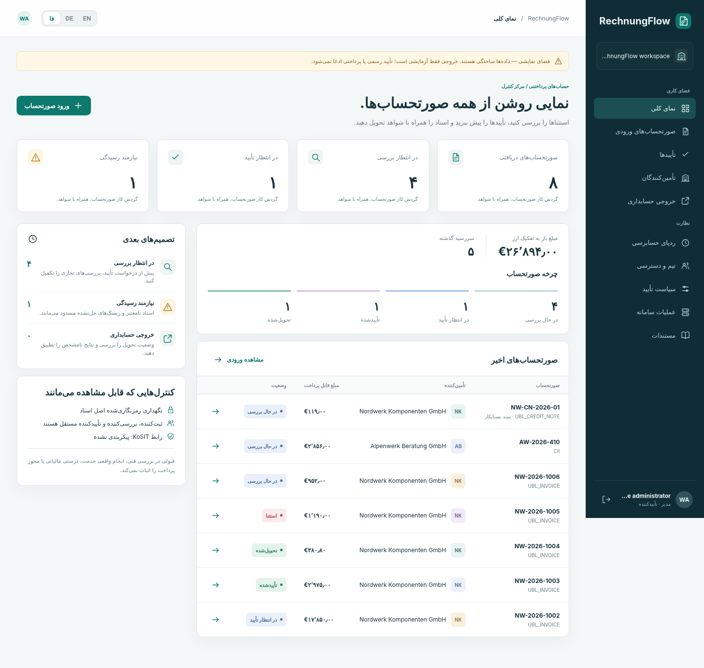

# RechnungFlow.

**ورود صورتحساب الکترونیکی آلمان، تأیید مستقل و تحویل مقاوم به حسابداری.**

[English](README.md) · [Deutsch](README.de.md).

Java 21 · XML با UBL و CII · انگلیسی، آلمانی، فارسی · پیش‌نمایش مهندسی تک‌گرهی.



## قابلیت پیاده‌شده.

اصل رمز‌شده و بدون تغییر، ورود XML با کنترل namespace، تکرار و اصلاح، کنترل منطقی محدود، اتصال جدا به KoSIT با نسخهٔ ثابت، تاریخچهٔ اعتبارسنجی، تأیید بانک تأمین‌کننده، بررسی مستقل و تأیید آستانه‌ای، سیاست نسخه‌دار، صف ماندگار، رسیدگی UNKNOWN، نقش، کلید ورودی تاریخ‌دار، ممیزی، بستهٔ شواهد، CSV و رابط کامل سه‌زبانه.

**مرز نسخه:** پایهٔ پایلوت قابل اجراست، نه نرم‌افزار مالی دارای گواهی و آمادهٔ فروش بدون شرط. باینری واقعی KoSIT در این محیط دریافت نشد؛ پذیرش رسمی هنوز تأیید نشده است. STRICT بدون آن مسدود می‌شود. DEMO برچسب روشن و فقط خروجی داخلی دارد. PDF ترکیبی، Peppol، پرداخت، ERP دارای گواهی، HA، SSO و آرشیو دارای گواهی وجود ندارند. [شروط تجاری](docs/fa/commercial-readiness.md).

## اجرا.

با Java 21 یا جدیدتر فایل JAR آماده را اجرا کنید.

```cmd
java -jar rechnungflow-0.1.0.jar --demo
```

نشانی `http://127.0.0.1:8090` را باز کنید. رمز اولیه در نخستین اجرا نشان داده می‌شود. فضای کاری `demo` و حساب‌ها `admin`، `intake`، `reviewer`، `approver`، `approver2`، `finance` و `auditor` هستند. این‌ها حساب واقعی تولید نیستند.

ساخت از منبع در CMD با JDK 21+ و Python 3.10+.

```cmd
scripts\build.cmd
scripts\test.cmd
scripts\run-demo.cmd
```

در Linux/macOS از `python3 scripts/build.py`، `python3 scripts/test.py` و سپس `java -jar build/rechnungflow-0.1.0.jar --demo` استفاده کنید. اجرای macOS اینجا بررسی نشده است.

## معماری و شواهد.

چهار ماژول منبع بدون دریافت وابستگی به یک JAR تبدیل می‌شوند. اعتبارسنج اختیاری جدا اجرا می‌شود. وضعیت رمز‌شده اتمی و تک‌فرایندی است، نه پایگاه رابطه‌ای تولید. پروندهٔ عادی سه شخص و مبلغ زیاد چهار شخص لازم دارد. اعتبار فنی، تأیید انسانی و رسید حسابداری یک چیز نیستند.

[شروع](docs/fa/quickstart.md) · [کاربر](docs/fa/user-guide.md) · [معماری](docs/fa/architecture.md) · [API](docs/fa/api.md) · [امنیت](docs/fa/security.md) · [اعتبارسنجی](docs/fa/validation.md) · [بهره‌برداری](docs/fa/operations.md) · [آزمون](docs/fa/testing.md) · [استقرار](docs/fa/deployment.md) · [پژوهش](docs/fa/research.md) · [GitHub با CMD](docs/fa/github.md).

گزارش واقعی محلی در [docs/evidence](docs/evidence) است. آزمون واسط مرورگر، نبود پذیرش رسمی و پلتفرم اجرا‌نشده جدا ثبت شده‌اند. درصد پوشش یا موفقیت CI ساختگی اعلام نمی‌شود.

کد اصلی MIT است؛ پیش از انتشار LICENSE را بررسی کنید. KoSIT اختیاری مجوز خودش را دارد و همراه بسته نیست. سند مشتری یا راز را مشارکت نکنید.
