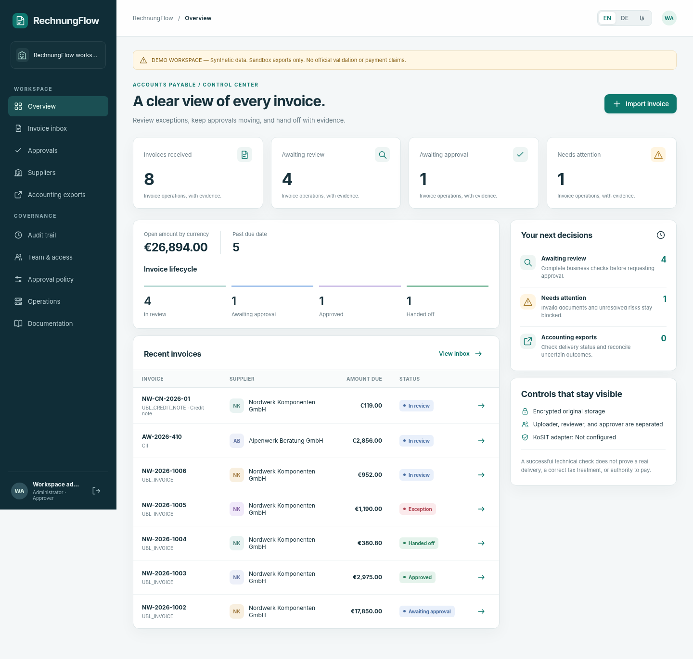

# RechnungFlow.

**German e-invoice intake, independent approvals, and resilient accounting handoff.**

[Deutsch](README.de.md) · [فارسی](README.fa.md).

Java 21 · UBL / CII XML · English / German / Persian · Single-node engineering preview.



## What is implemented.

Immutable encrypted originals, namespace-aware XML intake, duplicate and correction handling, bounded plausibility checks, isolated pinned KoSIT integration, preserved validation history, supplier-bank verification, independent review and threshold approvals, versioned policies, durable export jobs, explicit UNKNOWN recovery, role-based access, expiring intake keys, audit history, evidence ZIPs, CSV register, and a complete three-language browser interface.

**Release boundary:** this is a functional pilot foundation, not certified sell-ready financial software. Actual KoSIT binaries could not be downloaded in the build environment; genuine official acceptance remains unverified. STRICT fails closed without it. DEMO is clearly labeled and exports only to a sandbox. There is no hybrid-PDF extraction, Peppol transport, payment initiation, certified ERP adapter, HA, SSO, or legally certified archive. Read [commercial gates](docs/en/commercial-readiness.md).

## Run now.

With Java 21+, run the distributed JAR.

```cmd
java -jar rechnungflow-0.1.0.jar --demo
```

Open `http://127.0.0.1:8090`. The first startup prints a generated password. Workspace: `demo`. Accounts: `admin`, `intake`, `reviewer`, `approver`, `approver2`, `finance`, `auditor`. These are synthetic demo identities, not production accounts.

Build and test from Windows CMD with JDK 21+ and Python 3.10+.

```cmd
scripts\build.cmd
scripts\test.cmd
scripts\run-demo.cmd
```

Linux/macOS: `python3 scripts/build.py`, `python3 scripts/test.py`, then `java -jar build/rechnungflow-0.1.0.jar --demo`. macOS execution is not verified here.

## Architecture.

Four source modules compile offline into one dependency-free application JAR. The optional official validator runs separately. Encrypted snapshot storage is atomic and single-process; it is not a production relational database. A normal case needs three distinct people; high-value cases need four. Approval, official validation, and accounting acknowledgement are deliberately separate facts.

## Documentation and verification.

[Start](docs/en/quickstart.md) · [User guide](docs/en/user-guide.md) · [Architecture](docs/en/architecture.md) · [API](docs/en/api.md) · [Security](docs/en/security.md) · [Validation](docs/en/validation.md) · [Operations](docs/en/operations.md) · [Tests](docs/en/testing.md) · [Deployment](docs/en/deployment.md) · [Research](docs/en/research.md) · [Publish with CMD](docs/en/github.md).

Actual local reports live in [docs/evidence](docs/evidence). They distinguish Java/HTTP execution, browser harness, unavailable official acceptance, and unrun platforms. Do not infer a code-coverage percentage or a passing hosted Actions run from the presence of tests.

## License and contributions.

MIT for original project code; review LICENSE before publishing. Optional KoSIT and its dependencies retain their own licenses and are not bundled. Never contribute customer invoices or secrets. See [CONTRIBUTING](CONTRIBUTING.md), [SECURITY](SECURITY.md), and [commercial readiness](docs/en/commercial-readiness.md).
