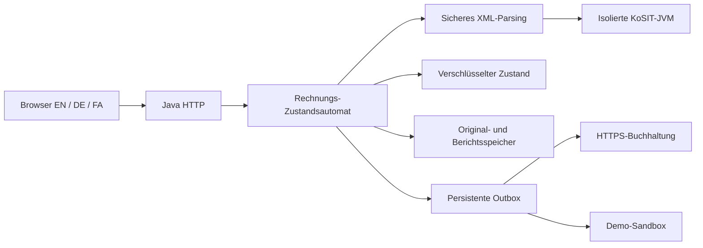

# Architektur und Entscheidungen.

## Module.

`invoice-core` umfasst JSON, exakte Dezimalwerte, Kryptografie, Speicherung, Akteure und Auditverkettung. `invoice-ingest` übernimmt XML-Schutz, UBL-/CII-Extraktion, begrenzte Plausibilitätsprüfungen und gepinnte Validatorprozesse. `invoice-workflow` enthält autorisierte Zustandswechsel, Lieferanten, Richtlinien, Anmeldung und Zustellungswiederherstellung. `invoice-server` stellt HTTP, Startkonfiguration, Demodaten, Wartungsbefehle und Oberfläche bereit.

Getrennte Quellmodule werden offline zu einer JAR-Datei kompiliert. Spring Boot, Hibernate, React oder ein verdeckter SaaS-Dienst werden nicht verwendet. Virtuelle Java-Threads bedienen begrenzt parallele Anfragen. Wenige Abhängigkeiten verbessern die Reproduzierbarkeit, ersetzen aber keine unabhängige Prüfung der eigenen HTTP- und Authentifizierungslogik.

## ADR 001: modularer Monolith.

Freigaberegeln, Auditereignisse und Outbox-Änderungen werden gemeinsam serialisiert gespeichert. Vor Bestätigung wird der vollständige verschlüsselte Zustand atomar ersetzt. Eine Prozesssperre verhindert konkurrierende Instanzen. Dies ist eine Pilotarchitektur, keine Hochlast- oder Hochverfügbarkeitslösung. Der Zustand ist auf 64 MiB begrenzt; jede Änderung schreibt den Snapshot neu. PostgreSQL, Indizes, verteilte Arbeitsübernahme und Lastqualifikation bleiben offene Produktreifeziele.

## ADR 002: Nachweise erhalten, Ausführung isolieren.

Originale und Berichte verwenden Inhaltshashes, AES-GCM und mandantenbezogene authentifizierte Daten. Hashes beweisen weder Urheberschaft noch externe Zeitstempel, WORM-Eigenschaften oder die Vollständigkeit eines entfernten Logendes. KoSIT läuft mit begrenztem Speicher und Zeitbudget in einer separaten JVM mit kontrollierten lokalen Eingaben. Hochgeladene Skripte werden nicht ausgeführt.

## ADR 003: unklare Zustellung sichtbar machen.

Erfolg benötigt eine Empfangskennung. Netzwerkunsicherheit wird `UNKNOWN`, nicht blind wiederholt. Beim Neustart werden laufende Übergaben als unklar markiert. Automatische Wiederholung setzt einen ausdrücklichen Idempotenzvertrag des Ziels voraus. Genau-einmal-Zustellung über unabhängige Systeme wird nicht behauptet.
