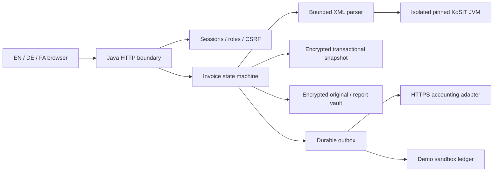

# Architecture and decisions.

## Module responsibilities.

`invoice-core` contains exact JSON/decimal handling, cryptography, storage, actors, and audit chaining. `invoice-ingest` contains XML hardening, UBL/CII extraction, bounded plausibility checks, validator pin verification, and isolated official-tool invocation. `invoice-workflow` owns authorization-aware business transitions, suppliers, policies, authentication, and export recovery. `invoice-server` supplies HTTP, startup, demo data, maintenance commands, and static interface assets.

The repository has separate source modules but the offline compiler packages one JAR. There is no Spring Boot, Hibernate, React, or hidden SaaS dependency. Java virtual threads serve bounded concurrent HTTP requests. Deliberately small dependencies make the demo reproducible; they do not remove the need to review the custom HTTP/authentication implementation before production.

## ADR 001: modular monolith, not distributed services.

Approval invariants, audit events, and outbox changes commit in one serialized transaction. A whole-state encrypted snapshot is atomically replaced before the in-memory state is accepted. Only one process owns the data lock. This is suitable for a small pilot, not a high-volume or highly available installation. The encoded state is limited to 64 MiB; each write rewrites the snapshot. PostgreSQL migration, indexes, transactional job claiming, and load qualification are commercial gates, not implemented features.

## ADR 002: preserve evidence, isolate execution.

Originals and reports use content hashes, AES-GCM and tenant-bound authenticated data. Hashes detect changes but do not establish authenticity, external timestamping, WORM storage, or complete log retention. KoSIT runs in a bounded child JVM with reviewed local inputs; no arbitrary uploaded script executes.

## ADR 003: explicit delivery uncertainty.

A receipt is required for success. Network ambiguity is `UNKNOWN`, not automatic replay. In-flight jobs become unknown after restart. Safe retries depend on an explicit destination idempotency contract. The design does not claim exactly-once delivery across independent systems.
