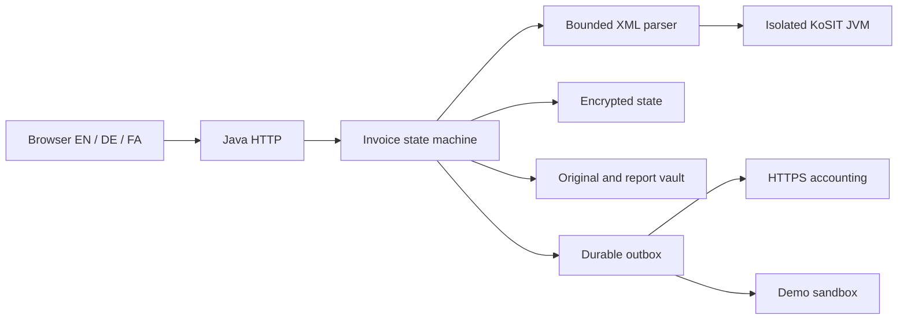

# معماری و تصمیم‌ها.

## مسئولیت ماژول‌ها.

`invoice-core` شامل JSON و اعشار دقیق، رمزنگاری، ذخیره‌سازی، هویت عامل و زنجیرهٔ ممیزی است. `invoice-ingest` حفاظت XML، استخراج UBL و CII، کنترل‌های محدود منطقی و اجرای اعتبارسنج ثابت‌شده را دارد. `invoice-workflow` مسئول انتقال‌های مجاز، تأمین‌کننده، سیاست، ورود و بازیابی خروجی است. `invoice-server` مرز HTTP، تنظیمات شروع، دادهٔ نمایشی، فرمان نگه‌داری و رابط را فراهم می‌کند.

ماژول‌های منبع جدا هستند ولی کامپایل آفلاین یک JAR می‌سازد. Spring Boot، Hibernate، React یا سرویس ابری پنهان استفاده نشده است. پردازش HTTP با ترد مجازی Java و سقف هم‌زمانی انجام می‌شود. وابستگی کم اجرای نمونه را تکرارپذیر می‌کند، اما بازبینی مستقل پیاده‌سازی ورود و HTTP همچنان لازم است.

## تصمیم ۰۰۱: برنامهٔ یکپارچهٔ ماژولار.

قواعد تأیید، رویداد ممیزی و صف خروجی در یک تراکنش سریالی ذخیره می‌شوند. پیش از تأیید تغییر، تصویر کامل وضعیت رمزگذاری‌شده به‌صورت اتمی جایگزین می‌شود. قفل فایل تنها یک فرایند را مجاز می‌کند. این معماری برای پایلوت کوچک است، نه بار زیاد یا دسترس‌پذیری بالا. وضعیت سقف ۶۴ MiB دارد و هر تغییر کل تصویر را بازنویسی می‌کند. مهاجرت PostgreSQL، ایندکس، برداشت کار تراکنشی و آزمون بار هنوز شرط عرضهٔ تجاری هستند.

## تصمیم ۰۰۲: حفظ شواهد و جداسازی اجرا.

اصل و گزارش با هش محتوا، AES-GCM و دادهٔ احراز اصالت وابسته به مستأجر ذخیره می‌شوند. هش به‌تنهایی اصالت صادرکننده، زمان‌سنجی خارجی، WORM یا کامل بودن انتهای لاگ را ثابت نمی‌کند. KoSIT در JVM فرزند با ورودی محلی بررسی‌شده و سقف زمان و حافظه اجرا می‌شود. اسکریپت بارگذاری‌شده اجرا نمی‌شود.

## تصمیم ۰۰۳: نتیجهٔ نامعلوم صریح.

موفقیت به رسید نیاز دارد. ابهام شبکه `UNKNOWN` می‌شود و خودکار تکرار نمی‌شود. پس از راه‌اندازی مجدد، کار نیمه‌تمام نامعلوم می‌شود. تکرار امن مستلزم قرارداد روشن عدم تکرار در مقصد است. تحویل دقیقاً یک‌بار بین سامانه‌های مستقل ادعا نشده است.
